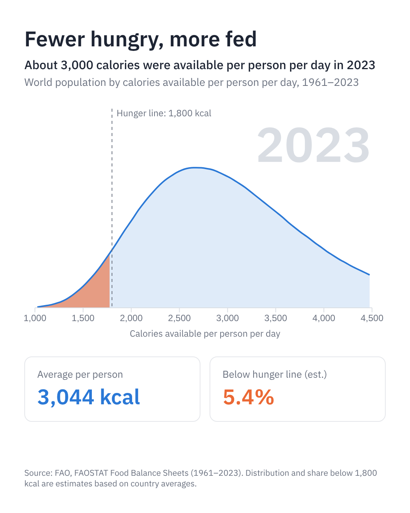

# fewer_hungry_more_fed_dataviz

# Fewer hungry, more fed
 
An animated D3.js visualisation of how the world's food supply changed between 1961 and 2023.
 
The chart shows the world's population spread across calories available per person per day. Press play and the whole curve moves to the right year by year. The orange area marks the estimated share of people below a 1,800 kcal hunger line.
 

 
## What it shows
 
| | 1961 | 2023 |
|---|---|---|
| Calories available per person per day (world average) | about 2,200 | just over 3,000 |
| People counted | about 3 billion | about 8 billion |
| Estimated share below 1,800 kcal | about 1 in 3 | about 1 in 20 |
 
The world now has enough food in total for everyone. Most hunger today is caused by poverty, conflict and poor access to food, not by a global shortage.
 
## Files
 
| File | What it is |
|---|---|
| `index.html` | The visualisation: HTML, CSS and D3 code in one file |
| `calorie_distribution.csv` | One row per year and 50 kcal band, giving millions of people in each band |
| `calorie_stats.csv` | One row per year: population, average kcal and estimated % below 1,800 kcal |
 
### CSV columns
 
`calorie_distribution.csv`
 
| Column | Meaning |
|---|---|
| `year` | 1961 to 2023 |
| `kcal_from`, `kcal_to` | The calorie band, for example 1000 to 1050 |
| `kcal_mid` | Midpoint of the band, used for the x position |
| `people_millions` | Millions of people in that band |
 
`calorie_stats.csv`
 
| Column | Meaning |
|---|---|
| `year` | 1961 to 2023 |
| `population_bn` | People counted, in billions |
| `avg_kcal` | Population-weighted average kcal per person per day |
| `pct_below_1800` | Estimated % of people below 1,800 kcal |
 
## How to run it
 
Browsers block pages from loading local files directly, so run a small local server from the project folder:
 
```bash
python3 -m http.server 8000
```
 
Then open http://localhost:8000 and press the play button.
 
## How it's built
 
- **D3.js v7** draws everything: `d3.csv` loads the data, `d3.scaleLinear` turns data values into pixel positions, `d3.area` and `d3.line` draw the curve, and `d3.axisBottom` draws the axis.
- **Transitions** (`.transition().ease(d3.easeLinear)`) make the curve glide smoothly between years.
- **CSS variables** hold the colour palette, so the chart, cards and text all share the same colours.
- The layout is a 4:5 frame (540 × 675, or 1080 × 1350 at 2x) so it can be exported for social media.
I learned D3 from scratch while building this, using Claude as a step-by-step tutor: one concept at a time, from drawing a single circle to animating the full chart.
 
## Data and method
 
**Source:** Food and Agriculture Organization of the United Nations (FAO), FAOSTAT Food Balance Sheets.
 
- Current series (2010–2023): https://www.fao.org/faostat/en/#data/FBS
- Historic series (1961–2009): https://www.fao.org/faostat/en/#data/FBSH

**Method:**
 
1. For each country and year, I took food supply (kcal per person per day) and population from the Food Balance Sheets.
2. The FAO only publishes each country's average, so I modelled the spread of calories within each country as a log-normal curve around that average, with a coefficient of variation of 0.25. This is similar to the approach the FAO uses for its own hunger estimates.
3. I added up the curves for all countries, weighted by population, to get one world curve per year.
4. The share below 1,800 kcal is read from that combined curve.

**Caveats:**
 
- **Supply is not intake.** The figures are food available at shop and household level, including food that is later wasted.
- **The curve and hunger share are estimates.** The FAO's official undernourishment figure for recent years is around 8–9%, higher than this model's roughly 5%. The gap comes from the simpler method and from countries missing from the Food Balance Sheets, some of which are conflict zones with high hunger.
- **There's a method break in 2010**, when the FAO revised its Food Balance Sheets methodology. Averages before and after 2010 differ slightly.

## Credits
 
- Data: FAO, FAOSTAT. Please check the FAO's terms of use before reusing the data.
- Built with [D3.js](https://d3js.org).
- Font: [IBM Plex Sans](https://fonts.google.com/specimen/IBM+Plex+Sans).
****
